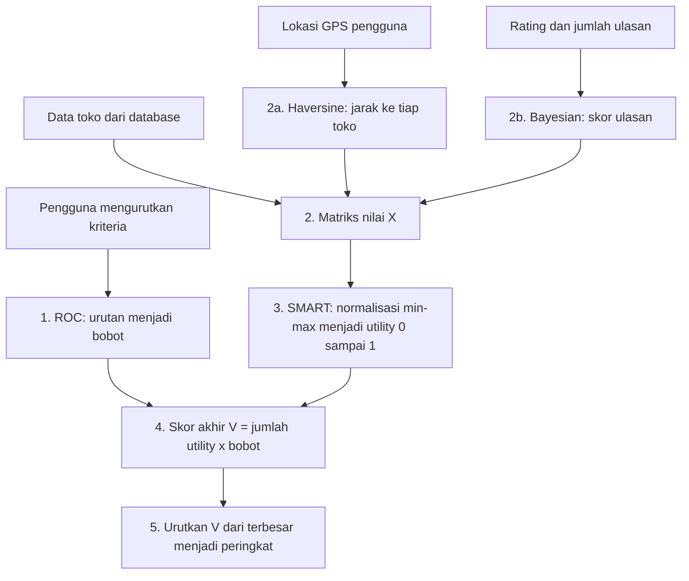

# Alur Metode ROC + SMART + Haversine

Dokumen ini menjelaskan alur perhitungan sistem rekomendasi toko thrift secara berurutan, lengkap dengan
contoh hitungan dari data sistem. Angka contoh dihitung ulang dengan kode sistem (`RocSmartService`),
dengan posisi pengguna di pusat Kota Jember (-8,1724; 113,7000).

## 1. Gambaran alur

| Metode | Menjawab pertanyaan |
|---|---|
| **ROC** | Seberapa penting tiap kriteria bagi pengguna ini? |
| **SMART** | Seberapa bagus tiap toko pada tiap kriteria? |
| **Haversine** | Seberapa jauh toko dari posisi pengguna? (menyiapkan nilai kriteria Lokasi) |
| **Bayesian Average** | Berapa skor ulasan yang adil, dengan memperhitungkan jumlah ulasan? (menyiapkan nilai kriteria Ulasan) |

Haversine dan Bayesian bukan bagian inti ROC-SMART. Keduanya hanya menyiapkan nilai dua kriteria agar objektif.

## 2. Kriteria

| Kriteria | Jenis | Sumber nilai |
|---|---|---|
| Harga | Cost | Skor tingkat harga 0–100 yang diinput admin (bukan rupiah). Makin tinggi berarti makin mahal. |
| Kualitas Produk | Benefit | Skor penilaian admin 0–100 |
| Kelengkapan Produk | Benefit | Skor penilaian admin 0–100 |
| Variasi Barang | Benefit | Skor penilaian admin 0–100 |
| Lokasi | Cost | Jarak Haversine (km) dari GPS pengguna. Nilai manual admin hanya cadangan untuk pengunjung tanpa GPS di beranda. |
| Ulasan | Benefit | Skor Bayesian dari rating dan jumlah ulasan |

*Cost*: makin kecil makin baik. *Benefit*: makin besar makin baik. Kriteria **Lokasi** dan **Ulasan** adalah kriteria inti
yang dikunci di sistem (tidak bisa dihapus atau diganti nama/jenisnya).

## 3. Langkah 1: Bobot dengan ROC (Rank Order Centroid)

Pengguna hanya mengurutkan kriteria dari yang paling penting. Rumus untuk kriteria peringkat *k* dari *m* kriteria:

`W_k = (1/m) × Σ (1/i)`, untuk i = k sampai m

Contoh urutan: Harga, Kualitas, Lokasi, Ulasan, Kelengkapan, Variasi (m = 6):

| Peringkat | Kriteria | Bobot |
|---|---|---|
| 1 | Harga | 0,4083 |
| 2 | Kualitas Produk | 0,2417 |
| 3 | Lokasi | 0,1583 |
| 4 | Ulasan | 0,1028 |
| 5 | Kelengkapan | 0,0611 |
| 6 | Variasi | 0,0278 |
| | **Total** | **1,0000** |

Contoh rank 1: (1 + 1/2 + 1/3 + 1/4 + 1/5 + 1/6) / 6 = 2,45 / 6 = 0,4083.

## 4. Langkah 2: Matriks nilai (X)

### 2a. Haversine (jarak garis lurus)

`a = sin²(Δlat/2) + cos(lat1) × cos(lat2) × sin²(Δlon/2)`

`jarak = 2 × R × atan2(√a, √(1−a))`, dengan R = 6371 km

### 2b. Bayesian Average (skor ulasan)

`skor = [ (n/(n+C)) × rating + (C/(n+C)) × m ] / 5 × 100`, dengan C = 10 dan m = 3,0.

- Toko dengan sedikit ulasan ditarik ke nilai netral (3 dari 5), sehingga tidak bisa dimanipulasi dengan satu ulasan bintang 5.
- Jika belum ada ulasan (n = 0), skor otomatis 60 (netral).
- Contoh Preloved Fashion Corner (rating 4,45; n = 112): 4,331 → **86,6**.

| Contoh n | Rating | Skor |
|---|---|---|
| 0 | 5 | 60,0 |
| 1 | 5 | 63,6 |
| 120 | 4,6 | 89,5 |

### Matriks X (data sistem)

| Toko | Harga | Kualitas | Lokasi (km) | Ulasan | Kelengkapan | Variasi |
|---|---|---|---|---|---|---|
| 1 Thrift Vintage Jember | 80 | 90 | 1,70 | 89,5 | 85 | 88 |
| 2 Secondhand Store Kampus | 60 | 78 | 1,61 | 80,5 | 80 | 82 |
| 3 Jember Thrift Central | 85 | 92 | 2,54 | 88,6 | 90 | 95 |
| 4 Oldschool Fashion Thrift | 75 | 88 | 0,86 | 83,9 | 75 | 80 |
| 5 Retroline Thrift Spot | 70 | 82 | 1,25 | 85,3 | 85 | 85 |
| 6 Garasi Thrift Jember | 55 | 75 | 2,56 | 75,0 | 70 | 78 |
| 7 Urban Thrift Outlet | 78 | 85 | 0,20 | 82,5 | 88 | 90 |
| 8 Preloved Fashion Corner | 65 | 84 | 2,30 | 86,6 | 82 | 84 |

## 5. Langkah 3: Utility dengan SMART (normalisasi min-max)

Agar kriteria berbeda satuan bisa dijumlahkan, nilai diubah ke skala 0–1:

- Benefit: `u = (C_i − C_min) / (C_max − C_min)`
- Cost: `u = (C_max − C_i) / (C_max − C_min)`

Jika semua toko bernilai sama pada suatu kriteria (max = min), utility diberi 1.

## 6. Langkah 4 dan 5: Skor akhir dan peringkat

`V_i = Σ (utility × bobot)`, lalu toko diurutkan dari V terbesar.

### Contoh lengkap: Preloved Fashion Corner (peringkat 1)

| Kriteria | Nilai | Min–Max | Utility | Bobot | u × w |
|---|---|---|---|---|---|
| Harga (cost) | 65 | 55–85 | (85−65)/30 = 0,667 | 0,4083 | 0,2722 |
| Kualitas | 84 | 75–92 | (84−75)/17 = 0,529 | 0,2417 | 0,1279 |
| Lokasi (cost) | 2,30 | 0,20–2,56 | (2,56−2,30)/2,36 = 0,110 | 0,1583 | 0,0174 |
| Ulasan | 86,6 | 75,0–89,5 | (86,6−75)/14,5 = 0,800 | 0,1028 | 0,0822 |
| Kelengkapan | 82 | 70–90 | (82−70)/20 = 0,600 | 0,0611 | 0,0367 |
| Variasi | 84 | 78–95 | (84−78)/17 = 0,353 | 0,0278 | 0,0098 |
| | | | | **V** | **0,5463** |

### Peringkat lengkap untuk urutan tersebut

| Peringkat | Toko | V |
|---|---|---|
| 1 | Preloved Fashion Corner | 0,5463 |
| 2 | Urban Thrift Outlet | 0,5235 |
| 3 | Secondhand Store Kampus | 0,5227 |
| 4 | Retroline Thrift Spot | 0,5218 |
| 5 | Oldschool Fashion Thrift | 0,5166 |
| 6 | Thrift Vintage Jember | 0,5039 |
| 7 | Jember Thrift Central | 0,4283 |
| 8 | Garasi Thrift Jember | 0,4083 |

## 7. Skenario demo (bukti bahwa peringkat mengikuti preferensi)

| Skenario prioritas | Peringkat 1 | Peringkat 2 | Peringkat 3 | Terbawah |
|---|---|---|---|---|
| Mahasiswa hemat: Harga > Lokasi > Ulasan > Kualitas > Kelengkapan > Variasi | Urban Thrift Outlet (0,554) | Secondhand Store Kampus (0,553) | Retroline (0,550) | Jember Thrift Central |
| **Pemburu kualitas**: Kualitas > Kelengkapan > Ulasan > Variasi > Harga > Lokasi | Jember Thrift Central (0,902) | Thrift Vintage Jember (0,781) | Urban Thrift Outlet (0,654) | Garasi Thrift |
| Yang dekat saja: Lokasi > Harga > Kualitas > Ulasan > Kelengkapan > Variasi | Urban Thrift Outlet (0,686) | Oldschool (0,577) | Retroline (0,543) | Garasi Thrift |

Saran demo: gunakan skenario **pemburu kualitas** (selisih skor jelas). Pada skenario "mahasiswa hemat" tiga besar hanya
berselisih sekitar 0,001, sehingga kurang meyakinkan sebagai contoh utama. Jember Thrift Central berpindah dari peringkat
terakhir ke peringkat 1 hanya karena urutan prioritas berubah.

## 8. Dua versi skor di aplikasi

| Halaman | Skor | Lokasi dihitung dari |
|---|---|---|
| Beranda (tanpa GPS) | Skor ROC-SMART umum | Nilai Lokasi bawaan toko (cadangan) |
| Beranda (GPS sudah diatur) | Skor ROC-SMART sesuai GPS | Jarak Haversine |
| Hasil rekomendasi `/user/hasil` | Skor personal | Jarak Haversine (default pusat kota jika GPS belum diatur, dengan peringatan) |

## 9. Kemungkinan pertanyaan penguji

**Kenapa ROC dan bukan AHP?**
AHP menuntut perbandingan berpasangan (15 pertanyaan untuk 6 kriteria) dan uji konsistensi, sehingga kurang praktis untuk
pengguna awam. ROC cukup meminta urutan prioritas dan langsung menghasilkan bobot.

**Kenapa SMART?**
Sederhana, transparan, mampu menangani kriteria cost dan benefit, dan langkahnya bisa ditunjukkan satu per satu
(akordeon transparansi di halaman hasil).

**Mengapa toko termurah tapi terburuk di semua kriteria lain (Garasi) mendapat 0,4083?**
Utility Harga = 1 dan lainnya = 0, sehingga skornya sama dengan bobot Harga. Normalisasi min-max bersifat relatif
terhadap toko yang dibandingkan: nilai 0 berarti terendah di antara toko yang ada, bukan nol mutlak.

**Mengapa skor 100% tidak berarti sempurna?**
Karena min-max relatif. Skor 100% berarti terbaik di antara alternatif yang ada.

**Mengapa memakai Bayesian untuk ulasan?**
Agar toko dengan sedikit ulasan tidak mengungguli toko dengan ulasan banyak hanya karena rating tinggi dari sedikit orang.

**Apa gunanya nilai Lokasi manual di admin?**
Hanya cadangan untuk pengunjung yang belum mengatur GPS di beranda. Bagi pengguna dengan GPS, jarak dihitung otomatis.

**Apakah nilai Harga dalam rupiah?**
Bukan. Skor tingkat harga 0–100 hasil penilaian admin (makin tinggi makin mahal).

## 10. Keterbatasan dan saran pengembangan

1. **Jarak garis lurus.** Haversine tidak memperhitungkan jalan. Saran: gunakan API jarak tempuh (OSRM atau Google Distance Matrix).
2. **Penilaian kriteria oleh admin bersifat subjektif.** Saran: libatkan beberapa penilai dan ambil rata-ratanya, atau gunakan data harga riil (rupiah).
3. **Normalisasi min-max relatif.** Skor berubah jika toko baru ditambahkan. Saran: gunakan batas skala tetap bila diperlukan skor absolut.
4. **Peta membutuhkan internet** (tile OpenStreetMap). Aset tampilan lainnya sudah lokal.
5. **Reset password** memakai `MAIL_MAILER=log` di lingkungan lokal; untuk produksi perlu SMTP.
6. **Konstanta Bayesian** (C = 10, m = 3,0) ditetapkan sebagai asumsi awal dan dapat dikalibrasi dengan data ulasan riil.
